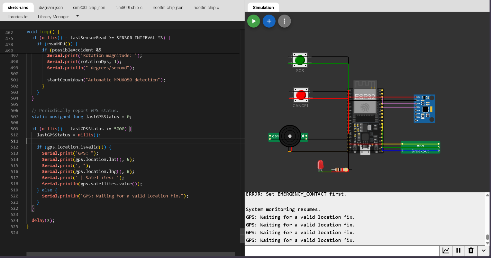
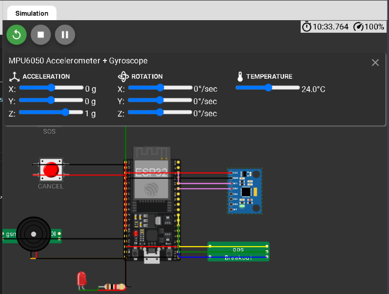
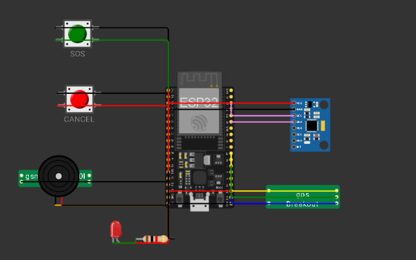
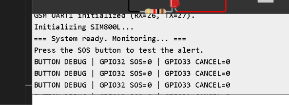

# IoT-Based Smart Helmet with Fall Detection and GPS Emergency Alerts

An IoT-based smart helmet prototype designed to improve rider safety through motion monitoring, GPS location tracking, and GSM-based emergency SMS alerts.

The system uses an ESP32 as the main controller, an MPU6050 for acceleration and rotational measurements, a NEO-6M GPS module for location data, and a SIM800L GSM module to attempt to send emergency SMS notifications.

---

## Project Overview

Road accidents can occur unexpectedly, making timely emergency notification and location reporting important for rider safety.

This project proposes an IoT-based smart helmet prototype that monitors movement and identifies possible crash-like events using programmed sensor thresholds. When a potential incident is detected, the system starts an emergency countdown. The rider can cancel the alert if the event is a false alarm.

If the countdown expires, the ESP32 prepares an emergency message and attempts to send it using the SIM800L GSM module. When a recent, valid GPS fix is available, the message includes the rider's coordinates and a Google Maps link.

A manual SOS button is also provided to allow the rider to initiate an emergency alert.

## Objectives

- Monitor acceleration and rotational movement using the MPU6050 sensor.
- Detect possible impacts or abnormal motion using programmed thresholds.
- Provide a countdown period to cancel potential false alarms.
- Enable manual emergency activation through an SOS button.
- Obtain geographical coordinates using the NEO-6M GPS module.
- Attempt to send emergency SMS notifications through the SIM800L GSM module.
- Provide audible and visual warnings through a buzzer and LED.
- Develop and test an affordable prototype using an ESP32 microcontroller.

## Features

- **Automatic crash detection:** Uses accelerometer and gyroscope readings to identify possible crash-like events.
- **Manual SOS:** Allows the rider to trigger an emergency countdown.
- **Emergency countdown:** Provides 10 seconds to cancel an alert.
- **False-alarm cancellation:** Uses a dedicated cancel button.
- **GPS location reporting:** Adds coordinates and a map link when a valid, recent location fix is available.
- **GSM SMS notification:** Attempts to send an emergency message through the SIM800L.
- **Buzzer alert:** Provides an audible warning during the countdown.
- **LED indicator:** Provides a visual warning.
- **Serial Monitor diagnostics:** Displays initialization messages, sensor-related events, GPS status, and GSM responses.

## System Architecture

```text
         MPU6050 Sensor
                |
                v
          +-----------+
          |   ESP32   |
          | Controller|
          +-----------+
           /    |    \
          /     |     \
         v      v      v
       GPS    SOS /   Buzzer
      NEO-6M  Cancel  and LED
         |
         v
   Location Data

          ESP32
             |
             v
       SIM800L GSM
             |
             v
     Emergency SMS
     with GPS Link
     when available
```

The ESP32 receives sensor measurements and button inputs, processes the programmed detection rules, controls the local warning indicators, and communicates with the GPS and GSM modules.

## Hardware Components

| Component | Purpose |
|---|---|
| ESP32 Dev Board | Main controller and processing unit |
| MPU6050 | Measures acceleration and angular velocity |
| NEO-6M GPS | Provides geographical coordinates |
| SIM800L GSM | Sends SMS alerts over a compatible cellular network |
| SOS push button | Manually initiates an emergency countdown |
| Cancel push button | Cancels a pending alert |
| Buzzer | Produces an audible warning |
| LED | Provides a visual warning |
| LED resistor | Limits current through the LED |
| Battery | Supplies portable power |
| Charger and protection circuit | Supports appropriate battery charging and protection |
| Voltage regulator or suitable power supply | Provides the required supply voltage and current |
| Jumper wires and prototype board | Connect the electronic components |

## Pin Connections

The following table matches the pin assignments in `SmartHelmet.ino`.

| Component | Pin | ESP32 Connection |
|---|---|---|
| MPU6050 | SDA | GPIO 21 |
| MPU6050 | SCL | GPIO 22 |
| MPU6050 | VCC | 3.3V, if supported by the breakout |
| MPU6050 | GND | GND |
| NEO-6M | TX | GPIO 16 |
| NEO-6M | RX | GPIO 17 |
| SIM800L | TXD | GPIO 26 |
| SIM800L | RXD | GPIO 27 |
| SOS button | Signal | GPIO 32 |
| Cancel button | Signal | GPIO 33 |
| Buzzer | Positive | GPIO 25, if electrically compatible |
| Buzzer | Negative | GND |
| LED | Anode | GPIO 13 through a suitable resistor |
| LED | Cathode | GND |

**Button wiring:** The SOS and cancel buttons use `INPUT_PULLUP`. Each button connects its assigned GPIO pin to GND when pressed.

**UART wiring:** GPS TX connects to the ESP32's GPS RX pin, while SIM800L TXD connects to the ESP32's GSM RX pin. Verify voltage compatibility before connecting UART signals.

Refer to the project's `diagram.json` for the Wokwi circuit definition. Verify component names and pin mappings against the actual simulation and hardware.

## How It Works

### 1. System Initialization

When the ESP32 starts, it initializes the serial connection, buttons, buzzer, LED, MPU6050, GPS serial interface, and GSM modem.

### 2. Motion Monitoring

The MPU6050 supplies acceleration and rotational measurements. The ESP32 evaluates the readings against the configured detection thresholds.

### 3. Possible Crash Detection

When the programmed impact or combined motion conditions are met, the ESP32 starts a 10-second countdown.

The thresholds are initial prototype values and must be calibrated and tested. They are not validated crash-detection criteria.

### 4. Emergency Countdown

The buzzer and LED pulse during the countdown. The rider can press the cancel button to stop the pending alert.

### 5. GPS Location Retrieval

The ESP32 reads GPS data from the NEO-6M. If a valid, recent fix is available, the coordinates are added to the emergency message.

If a valid fix is unavailable, the message indicates that GPS location is unavailable.

### 6. Emergency SMS Attempt

When the countdown expires, the ESP32 constructs the emergency message and attempts to send it using the SIM800L GSM modem.

The manual SOS button can also initiate the countdown.

### 7. System Monitoring

The Serial Monitor displays system status, GPS availability, countdown information, and modem responses to help with troubleshooting.

## Software Requirements

- Arduino IDE
- ESP32 board support package by Espressif Systems
- TinyGPSPlus Arduino library
- USB data cable
- Wokwi simulator for compatible circuit simulation
- Compatible SIM card and cellular service for physical GSM testing

## Installation and Setup

### Step 1: Install Arduino IDE

Download and install Arduino IDE from the official Arduino website:

https://www.arduino.cc/en/software

### Step 2: Install ESP32 Board Support

Open Boards Manager in Arduino IDE, search for **esp32 by Espressif Systems**, and install it.

### Step 3: Install TinyGPSPlus

Open Library Manager, search for **TinyGPSPlus**, and install the library.

### Step 4: Open the Firmware

Open `SmartHelmet.ino` from this repository.

### Step 5: Configure the Emergency Contact

Find the emergency contact setting in the sketch:

```cpp
const char EMERGENCY_CONTACT[] = "+639XXXXXXXXX";
```

Replace the placeholder with the intended recipient's phone number in international format.

Do not publish a private phone number in a public repository. Consider keeping personal configuration in a separate local file excluded from Git.

### Step 6: Select the ESP32 Board

Connect the ESP32 using a USB data cable.

In Arduino IDE, select the board that matches your physical ESP32 and select its COM port.

### Step 7: Compile and Upload

1. Click **Verify** to compile the sketch.
2. Correct any reported errors.
3. Click **Upload** to upload the firmware.
4. Open Serial Monitor and select **115200 baud**.

### Step 8: Verify Initialization

Check the Serial Monitor for startup messages and any sensor or modem errors.

Test the buttons, GPS reception, and GSM functionality individually before attempting an integrated emergency test.

## Screenshots

### Wokwi Circuit Diagram


### Wokwi Simulation


### Arduino IDE Setup


### Serial Monitor Test Results


> **Note:** These image paths are placeholders until you add the corresponding screenshots. GitHub will display the images once the files exist at those paths. Only document results that you have actually observed.

## Testing and Expected Results

| Test | Procedure | Expected Behavior |
|---|---|---|
| ESP32 startup | Reset the board | Startup messages appear in Serial Monitor |
| MPU6050 detection | Start with the sensor connected | Sensor initialization succeeds |
| SOS button | Press the SOS button | Emergency countdown begins |
| Cancel button | Press Cancel during countdown | Countdown and warning indicators stop |
| Motion detection | Apply safe, controlled sensor movement | The programmed thresholds may trigger a countdown |
| GPS reception | Wait for a valid GPS fix | Coordinates are displayed |
| GSM response | Initialize the modem | The modem responds to AT commands |
| SMS test | Send an alert to an authorized test number | Verify whether the message reaches the receiving phone |

Record actual results and dates in a separate testing log or update this table after performing the tests.

Do not claim a test passed solely because the sketch compiled. Simulation results and physical hardware results should be recorded separately.

## Power Requirements and Safety

### SIM800L Power

The SIM800L can draw high current bursts, potentially approaching 2 A. Many SIM800L modules require a supply around 3.4–4.4 V, but the exact specifications of the module or breakout board must be checked.

**Do not power the SIM800L directly from the ESP32's 3.3V output.** Use an appropriate supply with sufficient current capability, compatible logic levels, and a common ground where required.

### Battery and Charging

Use a battery with suitable protection and a charger designed for its chemistry. A TP4056 charger module alone does not provide all the regulated power outputs that the complete system may require.

### Cellular Compatibility

The SIM800L uses 2G GSM. Confirm that a compatible network is available from the intended carrier before relying on SMS functionality.

### Physical Helmet Safety

- Do not drill, cut, or weaken a certified helmet shell.
- Secure electronics and wiring to prevent movement or detachment.
- Protect batteries against short circuits, heat, moisture, and physical damage.
- Test the circuit on a workbench before mounting it.
- Do not conduct dangerous riding tests or deliberately strike a helmet to trigger the sensor.

## Limitations

- The crash-detection algorithm uses simple thresholds and may produce false positives or miss actual accidents.
- Detection thresholds have not been validated for real-world crash scenarios.
- GPS location may be unavailable indoors or before a valid satellite fix is acquired.
- SMS functionality depends on the GSM module, power supply, SIM card, network coverage, and carrier compatibility.
- A modem's SMS submission confirmation does not guarantee that the recipient received or read the message.
- Wokwi behavior may differ from physical hardware behavior.
- This prototype is not a certified replacement for a helmet, emergency beacon, or dedicated safety system.

## Future Improvements

- Calibrate and evaluate crash-detection thresholds using controlled experiments.
- Add filtering and sensor-fusion techniques to reduce false alarms.
- Improve GPS status handling and emergency-message reliability.
- Add battery-level monitoring and low-battery warnings.
- Evaluate a cellular module compatible with available local networks.
- Add a documented enclosure and secure mounting design that does not compromise helmet protection.
- Perform systematic simulation and physical hardware testing.

## Project Structure

```text
IoT-Smart-Helmet/
│
├── SmartHelmet.ino
├── diagram.json
├── libraries.txt
├── README.md
├── .gitignore
│
├── docs/
│   ├── PROJECT_OVERVIEW.md
│   ├── WIRING.md
│   ├── SETUP.md
│   ├── TESTING.md
│   └── POWER_AND_SAFETY.md
│
└── screenshots/
    ├── wokwi-circuit.png
    ├── wokwi-simulation.png
    ├── arduino-ide-board.png
    └── serial-monitor.png
```

Some listed files and screenshots are organizational placeholders and must be added to the repository if they do not already exist.

## License

Hate.

---

**Disclaimer:** This project is intended for educational and experimental purposes. It has not been certified for rider safety or emergency response.
